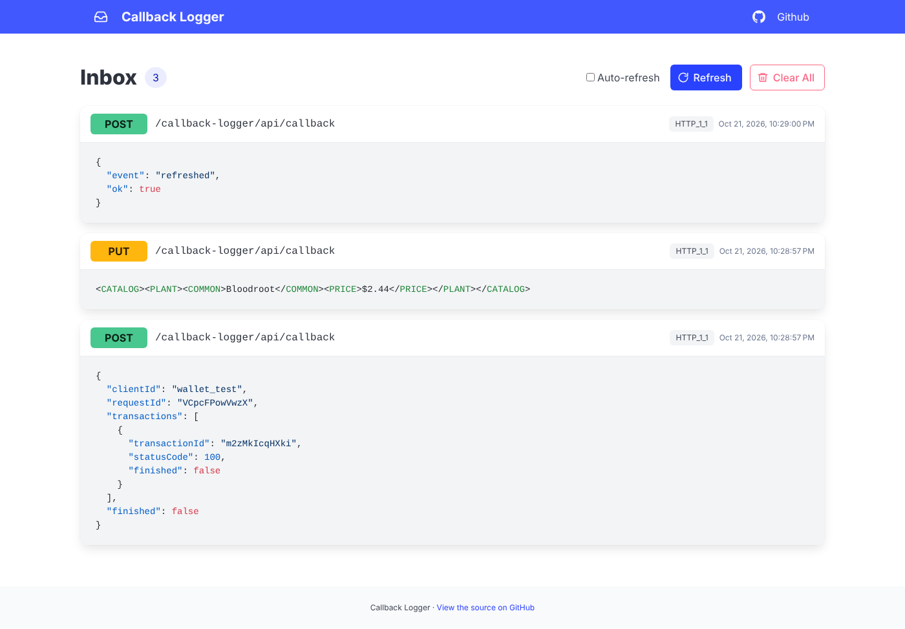

# callback-logger

[](https://github.com/leeturner/callback-logger/actions/workflows/build.yml)
[](LICENSE)

A small Kotlin and Micronaut service that receives callbacks, for testing APIs locally that send them. Point the API
at port `7071` and every request it sends is recorded, whatever its path, method or content type. Then watch them
arrive in the web UI on port `7070`.



## Features

- Records callbacks to any path with any HTTP method, using an embedded [WireMock](https://wiremock.org/) server
- A live inbox in the browser, with a **Copy as curl** button on every callback
- Configurable response status code, payload and content type
- Keeps the newest 1000 callbacks in memory by default, or as many as you choose
- Works offline: every asset the web UI needs is served by the app itself

## Requirements

- Java 25 or later (callback-logger runs on the JVM only; a GraalVM native image is not supported)

## Install

There are no releases yet, so build and run it from source:

```shell
git clone https://github.com/leeturner/callback-logger.git
cd callback-logger
./gradlew build run
```

## Usage

Callbacks are received by an embedded [WireMock](https://wiremock.org/) server on its own port, `7071`, while the
web interface stays on `7070`. Point the API you are testing at **any path** on the callback port, with **any HTTP
method**, for example `http://localhost:7071/callback` or `http://localhost:7071/orders/42/status`. Every request is
recorded, whatever its path, method or content type. You can send a callback manually using the following `curl`
request:

```shell
curl -X POST --location "http://localhost:7071/callback" \
    -H "Content-Type: application/json" \
    -d "{\"hello\": \"world\"}"
```

or

```shell
curl -X PATCH --location "http://localhost:7071/orders/42/status" \
    -H "Content-Type: application/xml" \
    -d "<hello>world</hello>" 
```

More examples, including form posts, query strings and custom methods such as `PROPFIND`, are in
[`src/test/resources/http/callbacks.http`](src/test/resources/http/callbacks.http).

Each callback in the inbox has a **Copy as curl** button that copies a `curl` command to send it to the callback
logger again.

Paths under `/__admin` are reserved by WireMock. Its admin API is locked, so those requests are refused with a `401`
and are not recorded as callbacks.

### Change the callback port

The callback port is set in the `application.conf` file:

```hocon
callback-logger {
  wiremock {
    port = 7071
  }
}
```

### Set the HTTP response code

By default, callback-logger returns a `200` response code for all callbacks.  If you need to return a different response
code then you can define the response code in the `application.conf` file.  For example:

```hocon
callback-logger {
  callback-response-status-code = 201
}
```

The application will fail to start if the response code is not a valid http response code.

### Set the HTTP response payload

By default, callback-logger returns an empty string as the response payload for all callbacks, with a
`Content-Type: application/json` header.  If you need to return a different response payload then you can change that
in the `application.conf` file.  For example:

```hocon
callback-logger {
  callback-response-payload = "{\"status\": \"OK\", \"message\": \"Callback received\"}"
}
```

### Set the HTTP response content type

By default, callback-logger returns a `Content-Type: application/json` header with every response, including when the
setting is missing or blank.  If your payload is in a different format then set the content type to match.  For
example, to return XML:

```hocon
callback-logger {
  callback-response-payload = "<status>OK</status>"
  callback-response-content-type = "application/xml"
}
```

The application will fail to start if the content type is not a valid media type, such as `xml` instead of
`application/xml`.

### Limit how many callbacks are kept

Callbacks are kept in memory, and by default only the newest `1000` are kept: once there are more, the oldest are
dropped. To keep a different number, set it in the `application.conf` file.  For example:

```hocon
callback-logger {
  max-callbacks = 5000
}
```

The application will fail to start if the number is not greater than zero.

### Web UI

The web interface shows the callbacks you have received. Open
`http://localhost:7070/callback-logger` in your browser.

New callbacks appear in the inbox as they arrive, and clearing or deleting them updates every open tab. Press
**Refresh** to reload the inbox on demand, **Clear All** to empty it, or the bin button on a callback to delete just
that one. All of them update the page in place using [Datastar](https://data-star.dev/), without a full page reload.
The page is styled with [Bulma](https://bulma.io/), and Bulma, Datastar and highlight.js are all served by the app
itself, so the inbox works with no internet connection.

## Building

Run the tests with:

```shell
./gradlew test
```

Bug reports and ideas are welcome in [issues](https://github.com/leeturner/callback-logger/issues).

## Licence

Apache License 2.0. See [LICENSE](LICENSE).
